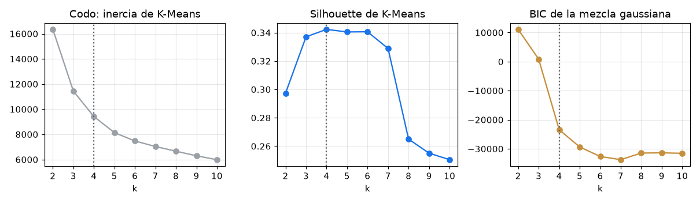

# customer-segmentation-clustering

Segmentación de clientes de **programas de formación ejecutiva** con clustering: recencia, frecuencia,
monto y engagement con campañas, selección de k con codo y silhouette, K-Means comparado con una mezcla
gaussiana, **estabilidad medida** y segmentos con nombre de negocio y una acción concreta por segmento. Es
una recreación, con datos 100 % sintéticos, de un caso de segmentación de postulantes y clientes de
formación ejecutiva.

> Este repositorio no contiene código, datos ni nombres de ningún cliente. Los clientes y su comportamiento
> se generan con una semilla.

## El problema

Un área comercial y de marketing le habla igual a toda su base: el mismo correo para quien está evaluando
su primer programa, para el ex-alumno que no abre nada hace un año y para la empresa que inscribe a su
equipo todos los semestres. El presupuesto se diluye y las cuentas de mayor valor no reciben una gestión
distinta.

## La solución

```text
clientes ──► 8 atributos de comportamiento ──► log1p en variables asimétricas ──► estandarización
                                                                                     │
               ┌─────────────────────────── k = 2…10 ────────────────────────────────┤
               │ inercia (codo) · silhouette de K-Means · BIC de la mezcla gaussiana  │
               └───────────────► k elegido (mayor silhouette) ◄──────────────────────┘
                                         │
              K-Means ──► estabilidad (20 semillas + bootstrap 80 %) · comparación con GMM
                                         │
              perfil por segmento ──► nombre de negocio (firma + algoritmo húngaro) ──► acción
```

- **Datos sintéticos** (`data.py`): 3.000 clientes generados desde 5 arquetipos latentes con ruido y
  solapamiento. Atributos: recencia, programas en 24 meses, monto total, tasa de apertura de correos, clics
  en campañas, webinars, antigüedad, si la empresa financió y canal de adquisición. El arquetipo real nunca
  entra al clustering; solo sirve para medir cuánto se recupera.
- **Preparación** (`pipeline.py`): `log1p` en recencia, frecuencia, monto, clics y webinars, y
  `StandardScaler`. El canal queda fuera del clustering porque es un atributo de origen, no de
  comportamiento; se usa para describir los segmentos.
- **Selección de k**: inercia con el método del codo (punto más alejado de la recta), silhouette por k y
  BIC de una mezcla gaussiana de covarianza completa.
- **Estabilidad**: ARI entre 20 corridas de K-Means con una sola inicialización por semilla, y ARI de 20
  reentrenamientos con el 80 % de los clientes contra la segmentación de referencia.
- **Perfilamiento**: tamaño, medianas, canal dominante y monto por segmento. Cada nombre de negocio tiene
  una firma (por ejemplo, recencia alta y engagement bajo = ex-alumnos dormidos). Los nombres se asignan
  con el algoritmo húngaro y solo se aceptan si la afinidad supera un mínimo; si no, el segmento queda como
  «sin firma clara» para revisión manual, en lugar de forzarle un nombre.

## Resultados medidos

Corrida por defecto (`--n 3000 --seed 42`).

**Selección de k**

| k | Inercia | Silhouette K-Means | BIC GMM |
|---:|---:|---:|---:|
| 2 | 16.346 | 0,297 | 11.095 |
| 3 | 11.440 | 0,337 | 839 |
| **4** | **9.417** | **0,342** | −23.452 |
| 5 | 8.141 | 0,340 | −29.353 |
| 6 | 7.475 | 0,341 | −32.639 |
| 7 | 7.036 | 0,329 | −33.733 |
| 8 | 6.664 | 0,265 | −31.461 |
| 9 | 6.296 | 0,255 | −31.388 |
| 10 | 5.990 | 0,251 | −31.546 |

El codo y la silhouette coinciden en **k = 4**; el BIC de la mezcla gaussiana prefiere k = 7. La silhouette
de 4 a 6 es casi igual (0,340 a 0,342), así que la elección entre esos valores es de negocio, no
estadística.



**Calidad y estabilidad con k = 4**

| Métrica | Valor |
|---|---:|
| Silhouette K-Means / mezcla gaussiana | 0,342 / 0,258 |
| ARI entre K-Means y mezcla gaussiana | 0,669 |
| ARI entre semillas (20 corridas, 1 inicialización): media / mínimo | 0,870 / 0,611 |
| ARI bootstrap 80 % contra la referencia: media / mínimo | 0,997 / 0,989 |
| ARI contra el arquetipo real (solo posible con datos sintéticos): K-Means / GMM | 0,544 / 0,310 |

Con una sola inicialización, alguna semilla cae en un mínimo local (ARI mínimo 0,611). Con 10
inicializaciones, que es lo que usa el modelo final, la segmentación casi no cambia al quitar un 20 % de
los clientes. K-Means supera a la mezcla gaussiana tanto en silhouette como en recuperación del arquetipo.

**Segmentos (k = 4)**

| Segmento | Clientes | % base | % del monto | Recencia (días) | Programas 24 m | Ticket medio (CLP) | Apertura | Clics 12 m | Financia empresa | Canal principal |
|---|---:|---:|---:|---:|---:|---:|---:|---:|---:|---|
| Interesados en evaluación | 893 | 30 % | 0 % | 26 | 0 | — | 61 % | 9 | 0 % | LinkedIn |
| Ex-alumnos dormidos | 823 | 27 % | 20 % | 319 | 1 | 688.000 | 15 % | 1 | 15 % | referido |
| Profesionales comprometidos | 655 | 22 % | 30 % | 59 | 2 | 935.500 | 68 % | 11 | 0 % | LinkedIn |
| Cuentas corporativas recurrentes | 629 | 21 % | 50 % | 62 | 3 | 1.405.000 | 52 % | 6 | 100 % | convenio empresa |

Valores de comportamiento: medianas del segmento; «financia empresa»: proporción de clientes.

| Segmento | Acción recomendada |
|---|---|
| Interesados en evaluación | Nutrir para convertir: clase de prueba, asesoría de admisión de 15 minutos y una oferta con fecha límite; medir la conversión a primera compra. |
| Ex-alumnos dormidos | Reactivar con bajo costo: encuesta corta y contenido de actualización para ex-alumnos; si no responden en 90 días, bajar la frecuencia de envíos. |
| Profesionales comprometidos | Ruta de especialización: ofrecer el siguiente programa con beneficio de continuidad y convertirlos en referidos con un incentivo. |
| Cuentas corporativas recurrentes | Gestión por ejecutivo de cuenta: plan anual de formación para la empresa, cupos prepagados y reporte de avance a RR. HH. |

La lectura para el negocio: un 21 % de la base concentra la mitad del monto y merece gestión de cuenta,
no campañas masivas, y un 30 % todavía no compra pero abre los correos y asiste a webinars.

**Lo que el clustering no encontró.** El arquetipo «comprador premium» (10 % de la base: una compra de
ticket alto y poco engagement) no aparece como segmento propio con ningún k entre 4 y 6: se reparte entre
los otros cuatro. Al forzar k = 5 o k = 6, los segmentos extra quedan marcados como «sin firma clara» en
vez de recibir un nombre que no corresponde. Detectarlo exigiría un atributo específico, como el ticket
máximo, o una regla de negocio aparte.

## Cómo usarlo

```bash
python3 -m venv .venv
.venv/bin/pip install -r requirements.txt

PYTHONPATH=src .venv/bin/python -m segmentation            # 3.000 clientes, semilla 42, k por silhouette
PYTHONPATH=src .venv/bin/python -m segmentation --k 5      # fijar k
PYTHONPATH=src .venv/bin/python -m segmentation --n 5000 --seed 7 --semillas 30

.venv/bin/python -m unittest discover -s tests
```

La corrida deja en `output/` los clientes con su segmento, la tabla de selección de k, los perfiles con
nombre y recomendación, y `metricas.json`, y actualiza `docs/seleccion_k.png`.

## Contexto del caso real

- Segmentación de postulantes y clientes de programas de formación ejecutiva a partir de su historial de
  compras e interacción con campañas.
- Segmentos con nombre de negocio y una acción por segmento, para que marketing y el equipo comercial
  priorizaran esfuerzos y mensajes.
- Las cifras de este repositorio salen solo de los datos sintéticos.

## Limitaciones

- Los datos son sintéticos y los arquetipos los definí yo; en datos reales no hay un «arquetipo real» con
  el cual comparar, y la validación pasa por la estabilidad y por la utilidad para el negocio.
- La silhouette es moderada (0,34): los segmentos se solapan, como ocurre con clientes reales. Conviene
  usarlos para priorizar, no como etiquetas rígidas.
- Las firmas de nombre y las recomendaciones son reglas de negocio explícitas; hay que revisarlas con el
  equipo comercial antes de usarlas.
- La segmentación es una foto: hay que recalcularla y medir la migración entre segmentos periódicamente.

## Stack

Python 3.10+ · numpy · pandas · scikit-learn · scipy · matplotlib · unittest

---

**Nicolás González Rojas** · Head of Data & BI · [LinkedIn](https://www.linkedin.com/in/nicolas-gonzalez-rojas)

> **Nota de rendimiento:** en equipos con muchos núcleos, fijar `OMP_NUM_THREADS=4` evita la sobrecarga de hilos de scikit-learn (en las pruebas, la corrida bajó de ~94 s a ~7 s).
